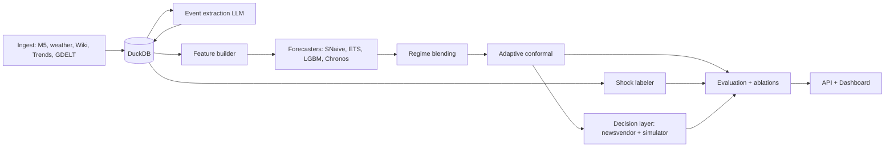

# Design Document

## Overview
A modular Python pipeline: ingest -> features -> models -> regime -> conformal -> decision, with a backtest harness orchestrating evaluation and an API/dashboard on top. DuckDB is the single store.

## Architecture


## Components and Interfaces

### Forecaster (src/shockcast/models/base.py)
```python
class Forecaster(Protocol):
    name: str
    def fit(self, train: pd.DataFrame, covariates: pd.DataFrame | None = None) -> None: ...
    def predict_quantiles(
        self, horizon: int, quantiles: Sequence[float],
        covariates: pd.DataFrame | None = None,
    ) -> pd.DataFrame: ...   # columns: series_id, ds, q_<level>
```

### EventExtractor (src/shockcast/events/extractor.py)
- Input: `TextItem(id, text, published_at, source)`.
- Output: `EventRecord` (Pydantic). Prompt versioned; responses cached in `event_cache`.

### Regime detector (src/shockcast/regime/)
- BOCPD on standardized residuals of the baseline model, plus signal-spike score.
- State machine: normal -> pre_shock (signal score high, series not yet moved) -> shock (run-length reset + deviation) -> recovery (decay back inside band).

### Adaptive conformal (src/shockcast/conformal/aci.py)
- Maintains per-series miscoverage level alpha_t, updated online:
  `alpha_{t+1} = alpha_t + gamma * (alpha_target - err_t)`, where err_t = 1 if y_t outside interval.
- Wraps any quantile forecaster; outputs calibrated lower/upper bounds.

### Decision layer (src/shockcast/decision/)
- Newsvendor: order quantity = forecast quantile at critical ratio `cu / (cu + co)`.
- Simulator: daily inventory with lead time L, reports stockout cost, holding cost, service level.

### Backtest harness (src/shockcast/evaluation/backtest.py)
- Rolling origins; for each origin: build features (<= origin), fit/predict, conformalize, evaluate, persist.

## Data Models
Database schema lives in `db/schema.sql` (source of truth). Key pydantic contracts:

```python
class EventRecord(BaseModel):
    text_id: str
    event_type: Literal["endorsement","weather","competitor","supply","promotion","holiday","viral","other"]
    direction: Literal["up","down","neutral"]
    magnitude: Literal["low","medium","high"]
    geography: str | None
    confidence: float  # 0..1
    published_at: datetime
    error: bool = False
```

## Error Handling
- Ingest: retry with exponential backoff; per-source failure isolation.
- LLM: schema validation + bounded retries; failures become flagged null events.
- Backtest: a failing model on one origin is logged and skipped; summary lists gaps.

## Testing Strategy
- Unit tests per module; leakage tests for each feature family.
- Property tests (hypothesis): conformal coverage near nominal on stationary data.
- Golden-file test: tiny fixed dataset reproduces expected metrics.
- Integration: end-to-end backtest on a 20-series subsample in CI.

## Key Decisions
- DuckDB over Postgres: zero-ops, fast analytics, easy reproducibility.
- Lagging by `published_at` is mandatory to prevent look-ahead leakage.
- Chronos used zero-shot first, fine-tuned only if ablations justify the cost.
